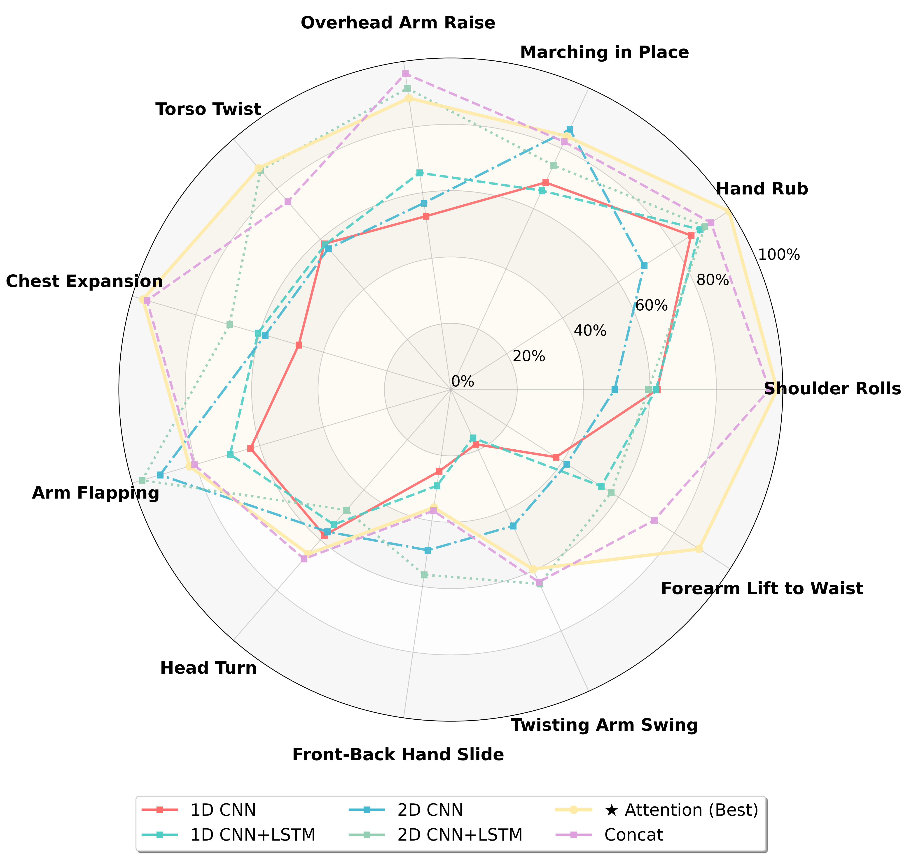

# mmWaveTryOn

PyTorch training and evaluation code for classifying 11 clothes try-on gestures from mmWave range–Doppler images, RGB-derived skeleton coordinates, or both. This release reconstructs the six models in Table 3 from the training-machine source history and archived checkpoints. [Paper](https://doi.org/10.1145/3737904.3768535) · [Authors’ project page](https://weixijia.github.io/mmWaveTryOn/)



**Figure 3 from the paper.** The skeleton CNN, skeleton CNN + LSTM and radar CNN curves show per-class F1. The radar CNN + LSTM, Concat and Attention curves show per-class recall. Some action labels in the published figure differ from the dataset mapping. For example, the “Shoulder Rolls” axis contains the arm-lift scores.

## Inputs and models

Each labelled clip contains 20 consecutive frames. The model determines which frames and transforms the loader uses.

| Model argument | Input used in the original experiments |
| --- | --- |
| `skeleton-cnn` | Last frame of each clip, 13 joints × 2 coordinates |
| `skeleton-lstm` | Same last frame, giving the LSTM a sequence length of one |
| `radar-cnn` | All 20 range–Doppler images, resized to 64 × 64 with ImageNet channel normalization |
| `radar-lstm` | Same 20 radar images and transform |
| `concat` | All 20 radar images at their native size, scaled to [0, 1], plus all 20 skeleton frames |
| `attention` | All 20 radar images, resized to 224 × 224 with ImageNet channel normalization, plus all 20 skeleton frames |

The two fusion models also differ in their classifier heads. The attention model adds batch normalization and stronger dropout. Their accuracy difference reflects the full configurations.

## Set up

The reference environment used Linux, Python 3.8.20, PyTorch 2.3.1 and an NVIDIA RTX 3090. From the repository root, install the dependencies into your Python environment.

```sh
python -m pip install -r requirements.txt
```

Supply the processed data in this layout. Skeleton-only runs read the CSV and can run without the image directory.

```text
Data_Processing/
  labels.csv
  All_RD_imgs/
    <PNG files named in the imagename column>
```

The CSV supplies the participant ID, action ID, frame number and image filename. Skeleton models also read the MediaPipe `pose_<joint>_x` and `pose_<joint>_y` columns. Keep the original frame order within each participant and action. The eight participant IDs, the 11 action IDs and the joint order are defined in [dataset.py](dataset.py).

## Train

Run all eight leave-one-person-out folds, or pass a test participant ID to run a single fold. Each fold uses six people for training, one for validation and one for testing.

```sh
python train.py --model radar-lstm --data-dir /path/to/Data_Processing
python train.py --model attention --data-dir /path/to/Data_Processing --test-person 1210175720
```

Use `--device cpu` for CPU execution. `--batch-size`, `--epochs`, `--num-workers` and `--output-dir` can be set on the command line. Each run writes its configuration, the best validation checkpoint for each fold, clip-level predictions, `folds.csv` and `summary.json`. Predictions retain the original action IDs.

The release saves an independent checkpoint whenever validation accuracy improves, then restores that checkpoint for testing. The historical trainer kept a shallow copy of the parameters, which could change during subsequent epochs. Fresh training therefore answers a different question from replaying the archived weights.

## Evaluate a checkpoint

A checkpoint created by this trainer records its model, action mapping and held-out participant. To evaluate it again on the same data, supply its path.

```sh
python evaluate.py --data-dir /path/to/Data_Processing --checkpoint /path/to/best.pt
```

For an archived model exported as a PyTorch tensor state dictionary, supply the model and its test participant explicitly.

```sh
python evaluate.py --data-dir /path/to/Data_Processing --checkpoint /path/to/state_dict.pt --model concat --test-person 1210175720
```

The evaluator prints the correct count, number of clips and accuracy. To run the preprocessing and split regression tests, use `python -m unittest test_benchmark`.

## Reference results

The eight test folds cover 2,029 labelled clips. Table 3 gives each participant equal weight. The standard deviations below use the eight folds as the population (`ddof=0`).

On the original RTX 3090, `evaluate.py` reproduced the recorded number of correct predictions in all 48 model–participant pairs using the archived weights. All six training configurations also completed a one-epoch run on a small real-data subset and reproduced their test counts after reloading the new checkpoints.

| Model | Mean accuracy (%) | SD (percentage points) |
| --- | ---: | ---: |
| Skeleton CNN | 58.64 | 13.27 |
| Skeleton CNN + LSTM | 64.45 | 14.41 |
| Radar CNN | 70.23 | 13.00 |
| Radar CNN + LSTM | 78.40 | 12.73 |
| Concat | 75.10 | 15.02 |
| Attention | 81.51 | 10.08 |
